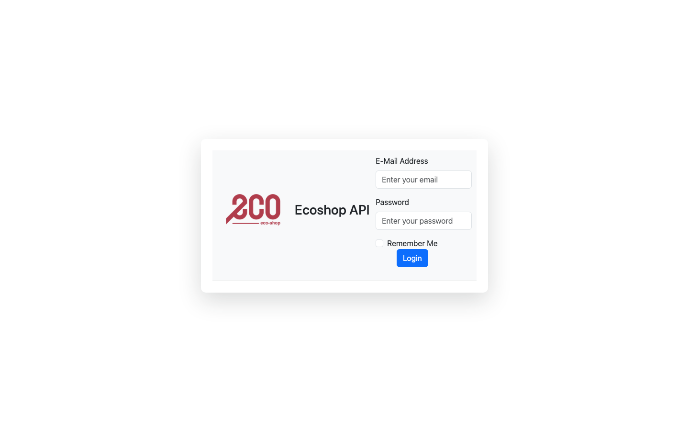

# Adjustment LOA – Stock Adjustment Approval Portal

A front-end prototype of an internal web portal for a retail chain. Managers use it to review and approve stock adjustments across outlets. LOA stands for *Limit of Authority*: each adjustment goes to a different approval level depending on its quantity or price.

Built during my internship at **Radiant GlobalTech** (Feb 2025).


| Approval by Quantity | Login |
| --- | --- |
|  |  |

## Pages

- **Login** (`LoginPage.html`)
- **Stock Adjustment Approval**: a listing of adjustment documents with their Approval 1 and Approval 2 status, plus a detail page for each document
- **Approval by Quantity / Approval by Price**: set the Level 1–3 approval thresholds for each outlet
- **Outlet Approvals**, **Outlets** and **Outlet Regional Settings**: manage outlets and their approvers
- **Authorization Management**: assign users to approval roles

All pages share a collapsible side navigation bar, filters and pagination. The data is hard-coded sample data, as this is a UI prototype with no backend.

## Tech stack

HTML5 · CSS3 · Bootstrap 5 · JavaScript · Font Awesome

## Running it

No build step is needed. Clone the repo and open `Adjustment-LOA/LoginPage.html` (or any other page) in a browser.

```bash
git clone https://github.com/bentez7/adjustmentloa.git
open adjustmentloa/Adjustment-LOA/LoginPage.html
```

## My role

I designed and built all of the pages in this repo: the layouts, the shared side navigation, the tables, the filters and pagination, and the approval-level settings screens.
