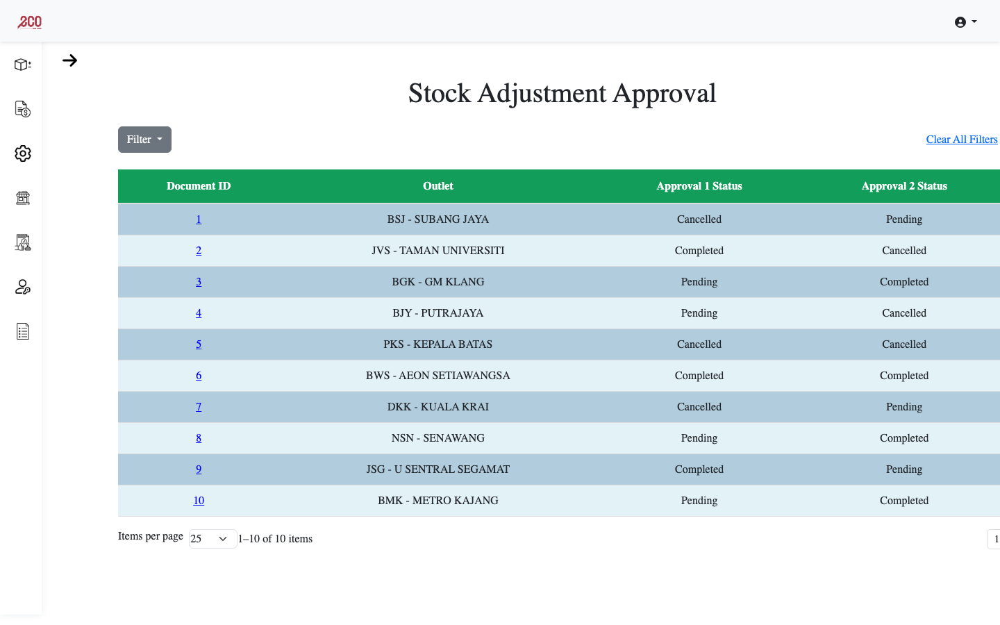
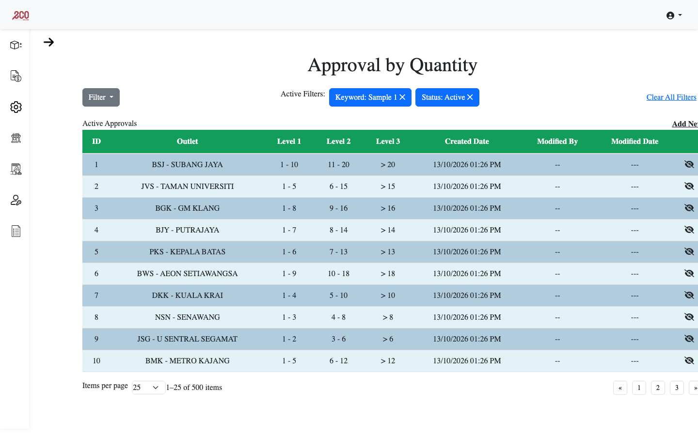
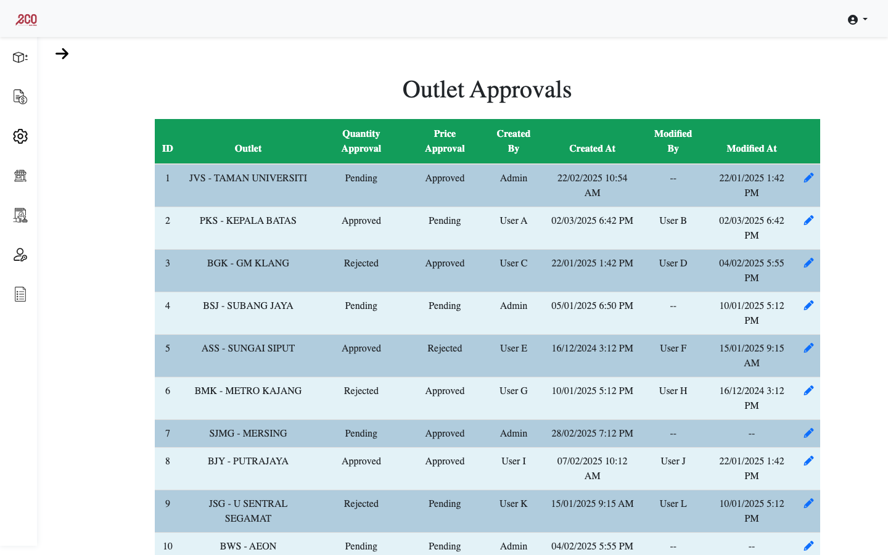

# Adjustment LOA – Stock Adjustment Approval Portal

A front-end prototype of an internal approval portal for a retail chain. Store managers raise stock adjustments, and those adjustments go through a configurable **limit of authority (LOA)** workflow. The portal lets admins review and approve adjustments, and set approval thresholds by quantity, by price and by outlet.

I built this during my internship at **Radiant GlobalTech**. It is a static HTML/CSS/JavaScript prototype that uses sample data hard-coded in the pages, so it has no backend.



| Approval by Quantity | Outlet Approvals |
| --- | --- |
|  |  |

## Pages

| Page | File | What it does |
| --- | --- | --- |
| Login | `Adjustment-LOA/LoginPage.html` | Sign-in screen |
| Main | `Adjustment-LOA/MainPage.html` | Landing page with the side navigation |
| Stock Adjustment Approval | `Adjustment-LOA/Stock Adjustment Approval/ListingPage.html` | Lists adjustment documents with each approval level's status, plus filtering and pagination |
| Stock Adjustment Detail | `Adjustment-LOA/Stock Adjustment Approval/DetailPage.html` | Item lines for one document, with approve and reject actions |
| Approval by Quantity | `Adjustment-LOA/Admin/QuantityApproval.html` | Sets the quantity thresholds for approval levels 1–3 for each outlet |
| Approval by Price | `Adjustment-LOA/Admin/PriceApproval.html` | Sets the price thresholds for approval levels 1–3 for each outlet |
| Outlet Regional Settings | `Adjustment-LOA/Admin/OutletRegionalSettings.html` | Defines regions and links each one to a quantity and a price approval rule |
| Outlet Page / Details | `Adjustment-LOA/Admin/OutletPage.html`, `OutletDetails.html` | Lists outlets with their region and status, with a detail view for each outlet |
| Outlet Approvals | `Adjustment-LOA/Admin/OutletApproval.html` | Reviews changes to outlet approval settings |
| Authorizations | `Adjustment-LOA/Admin/AuthorizationPage.html` | Manages roles and their access rights |

## Tech stack

- HTML5, CSS3 and vanilla JavaScript
- [Bootstrap 5.3](https://getbootstrap.com/) for layout, tables and modals
- [Font Awesome 6](https://fontawesome.com/) for icons

## Running it locally

You don't need to build or install anything.

1. Clone the repo:
   ```bash
   git clone https://github.com/bentez7/adjustmentloa.git
   ```
2. Open `Adjustment-LOA/LoginPage.html` or `Adjustment-LOA/MainPage.html` in a browser. Bootstrap and Font Awesome load from a CDN, so you need an internet connection.

You can also serve the folder instead of opening the files directly, for example with `python3 -m http.server` from inside `Adjustment-LOA/`, then go to `http://localhost:8000/MainPage.html`.

## My role

I built the front end on my own: the page layouts, the collapsible side navigation, the filterable and paginated approval tables, and the approve and reject modals. I worked from requirements given by the project team.
